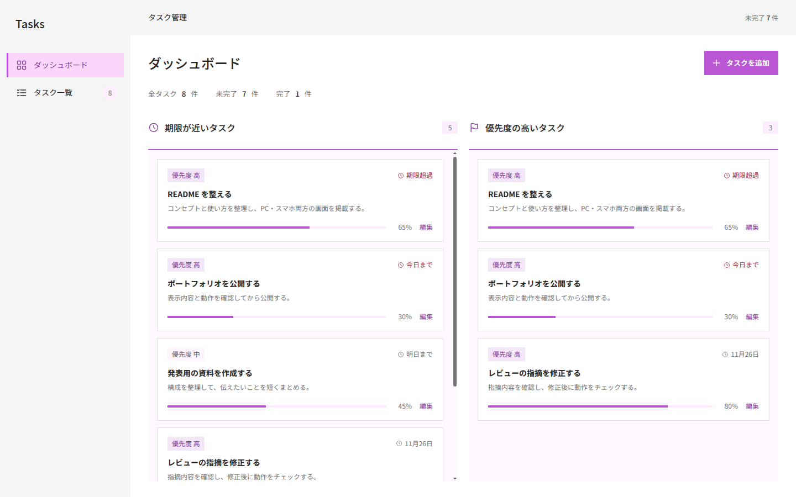
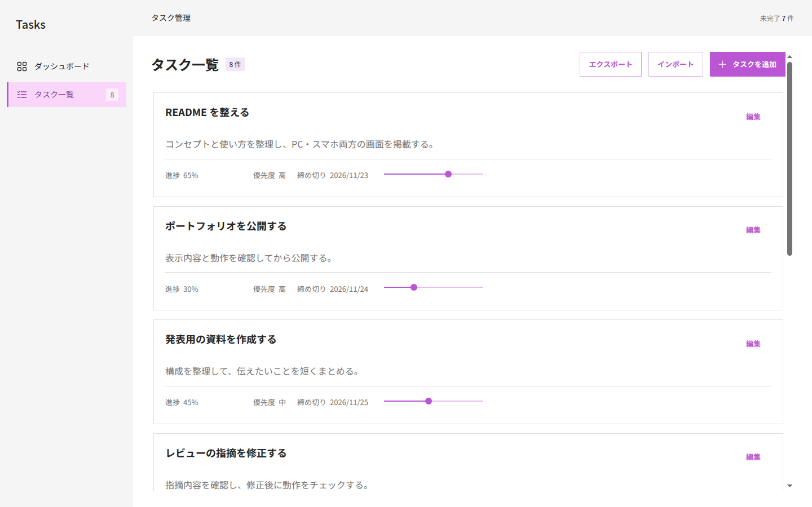
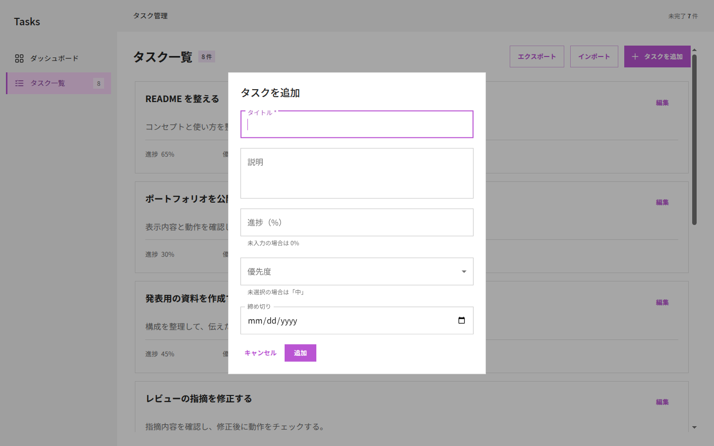
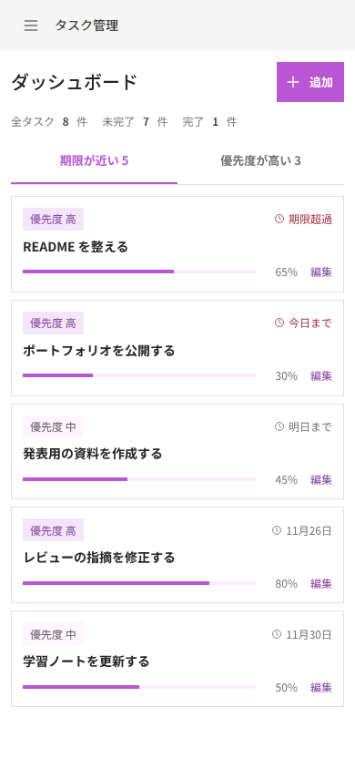
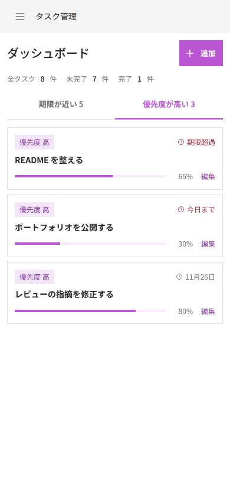
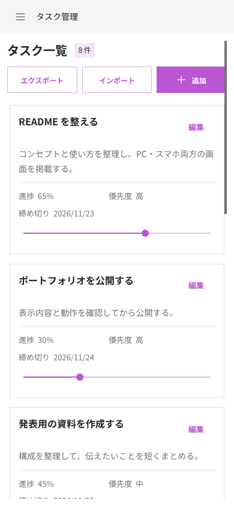

# Tasks

<strong>[使用開始](https://nekochan9382.github.io/basic-todo)</strong>

React・TypeScript で作成した、ブラウザだけで使えるタスク管理アプリです。

## コンセプト

**「一目で見られる画面」**

タスクを登録するだけでなく、いま何を進めるべきかをすぐに確認できることを目指しました。例えば、縦に長いページは必要な情報を得るためにスクロールをしていく必要があり、情報を見つけるまでのディレイがあります。それだけでなく、複数の情報を比較したいようなとき、スクロールしてページ内を往復しなければならないこともあり、とても面倒です。そこで、画面全体をスクロールするようなUIを排除し、ブロック内でのスクロールだけに留め、必要な情報がマウスを触らずにページを開いた瞬間得られる画面を目指しています。期限が近いタスクと優先度の高いタスクをダッシュボードに集め、一覧を探し回らずに次の作業を選べるようにしています。



## 機能

### タスクの作成・編集・削除

タイトル・説明・進捗度・優先度・締め切りを設定してタスクを作成できます。作成後も編集モーダルから内容を変更・削除できます。

- 進捗度：0〜100%。100%で完了と判定します。
- 優先度：「低」「中」「高」の3段階で設定できます。
- 締め切り：日付を指定するか、未設定のまま管理できます。



### ダッシュボードで重要なタスクを確認

未完了のタスクから、次の2種類を抜き出して表示します。各ブロックは締め切りが早い順に並びます。

| ブロック           | 表示するタスク                                                    |
| ------------------ | ----------------------------------------------------------------- |
| 期限が近いタスク   | 今日から7日後までに締め切りを迎えるタスクと、期限を超過したタスク |
| 優先度の高いタスク | 優先度が「高」のタスク。締め切り未設定のものも含む                |

### NDJSON 形式でのエクスポート・インポート

タスク一覧画面から、タスクを `.ndjson` ファイルとして保存・読み込みできます。ファイルは1行に1件のタスクを記録する形式です。

```jsonl
{"id":"1795478400000-0","title":"README を作成する","detail":"機能と工夫点をまとめる","progress":65,"priority":"high","due_date":"2026-11-30T03:00:00.000Z"}
{"id":"1795478400000-1","title":"学習ノートを整理する","detail":"","progress":0,"priority":"mid","due_date":null}
```

インポート時はファイル全体を検証してから追加します。既存タスクは維持し、同じ ID のタスクはスキップします。不正なデータがある場合は、該当する行番号を表示します。

## 工夫点

### タイトルだけで追加できる

タスクを追加するハードルを下げるため、タイトル以外の項目はすべて任意にしました。思いついたときにタイトルだけを登録し、説明や締め切りを後から補えます。追加モーダルを開くと、タイトル欄に自動でフォーカスします。そのままタイトルを打ち込み、Enterを押すだけでタスク追加が完了します。説明や締切などを考える間にタスク追加が面倒になってしまうことも少なくないと思うので、心理的ハードルの面からタスク管理の手軽さにアプローチしています。

未入力の場合は、説明は空欄、進捗度は0%、優先度は「中」、締め切りは未設定になります。



### 画面の広さに合わせて情報を整理

通常の PC 画面では、ダッシュボード全体をスクロールせずに表示し、各タスクブロック内だけをスクロールできるようにしました。見出しや件数を見失わずに、タスクを確認できます。

スマホでは「期限が近い」「優先度が高い」を件数付きのタブで切り替えます。PCと同様の縦方向に複数のタスクを表示するUIを一致させつつ、多軸のスクロールがあるようなUIにならないように配慮しています。本文だけをスクロールさせることで、ブロック内スクロールとの干渉を防いでいます。高さの低い PC 画面でも、同じタブ表示に切り替わります。

<p>
  
  
</p>

スマホのナビゲーションはハンバーガーメニューに収納し、タスクの表示領域を確保しました。一覧の操作ボタンは大きさを揃え、長い説明文は省略表示します。全文は編集画面で確認できます。

### スライダーですぐに進捗を変更

タスク一覧のスライダーから、進捗度を5%刻みで変更できます。わざわざ編集モーダルを開く必要がなく、作業が進んだタイミングですぐに更新できます。



### 変更の確定後に自動保存

タスクの追加・編集・削除や進捗の変更を確定すると、すぐに localStorage への保存を行います。保存ボタンを押すという操作そのものが存在しないので保存し忘れる心配はありません。次にアプリを開いたときに前回のタスクを復元します。

保存状態は固定ヘッダー内に表示します。保存に失敗した場合は変更を画面内に保持し、エラーと再試行ボタンを表示します。

### ファイルで端末間の受け渡しができる

NDJSON ファイルを別の端末へ渡してインポートすることで、クラウド同期を用いずにタスクを共有できます。1行ごとにタスクの各プロパティがまとまっているため、テキストエディターでも内容を確認しやすい形式です。

端末間での自動同期は行いません。また、同じ ID は上書きしないため、既存タスクを更新する用途ではなく、新しいタスクの受け渡しやバックアップの復元が主な用途となっています。

### MUIを用いたUI実装

各部品にMUIのコンポーネントを使用しています。モーダルやポップアップ等のUIを簡潔に実装しつつ、全体で一貫性を保っています。

## 技術スタック

| 分類              | 使用技術                            |
| ----------------- | ----------------------------------- |
| UI                | React 19、TypeScript 6              |
| 画面遷移          | React Router 7                      |
| UI コンポーネント | MUI 9、Emotion                      |
| スタイリング      | CSS Modules、CSS カスタムプロパティ |
| 開発・ビルド      | Vite 8、React Compiler              |
| データ保存        | localStorage                        |
| データ入出力      | NDJSON                              |
| 静的解析・整形    | Oxlint、Oxfmt                       |
| パッケージ管理    | pnpm                                |

## ローカルでの起動

```bash
pnpm install
pnpm dev
```

```bash
pnpm build                       # 型チェックと本番ビルド
pnpm preview                     # 本番ビルドをローカルで確認
pnpm lint                        # 静的解析
node --test tests/*.test.ts       # テスト（Node.js 24 以降）
```

## 制作期間

11/10 ~ 11/24 (approx. 18h)
